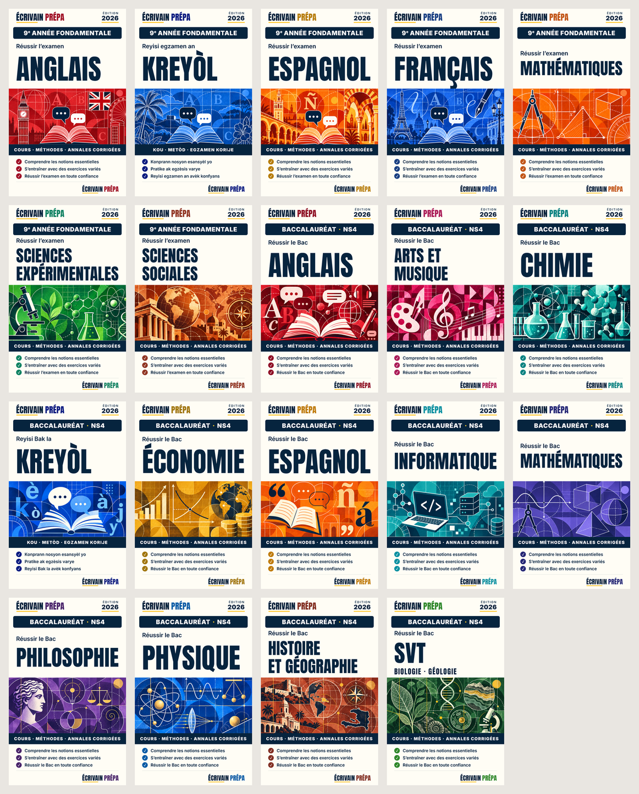

# Écrivain Prépa: cover collection

The editable front cover for the 19 Écrivain Prépa exam-prep books (7 for the 9e année fondamentale, 12 for the Baccalauréat NS4). It rebuilds the ChatGPT concept mockups (`Ecrivain_Prepa_19_Anonymous_Covers_Claude/`) as one template:
- **Template:** typography, layout and copy are live text.
- **Illustrations:** the panel art is cut from the mockups.



**The series is anonymous.** No personal name, pen name, "Anonymous" or author placeholder appears on a cover, in its metadata or in a file name. ÉCRIVAIN PRÉPA is the only name, as series and publisher brand. The books themselves are created with no author name, so no export (PDF, EPUB, DOCX) prints one.

## Files

- `cover.html`: the template, 1600 × 2560 px (digital front cover). It reads `window.COVER` and lays everything out.
- `specs.py`: each subject's title and colours, and the copy (French, or Kreyòl for the two Kreyòl books). Writes `specs.json`.
- `art/<book>.jpg`: the illustration panels, cut from the mockups at 1600 px wide. A `.png` with the same name takes precedence.
- `render.cjs`: renders `front/<book>.png` with Playwright (Chromium, from `api/node_modules`).
- `sheet.py`: contact sheet (`sheet-front.png`).

## Design rules

- **Tokens:** ivory #FFFDF5 (paper), navy #06243E (type, level bar, promise band), yellow #FFC62B (wordmark and edition underlines). The subject colour, darkened for type, is used for PRÉPA and the check marks.
- **Zones:** nothing crosses a zone boundary.

  | Zone | Rows (px) |
  |---|---|
  | Header | 0–230 |
  | Level bar | 250–410 |
  | Title | 440–1060 |
  | Illustration | 1090–1850 |
  | Promise band | 1850–2000 |
  | Benefits | 2050–2320 |
  | Footer | 2360–2560 |

  The side margin is 100 px.
- **Title:** the subject takes the largest size, up to 380 px, at which the kicker and title fit the title zone; the block is centred in it. Titles are measured only once the fonts and art have loaded.
- **Words stay whole:** a title breaks only between words, where `specs.py` puts a `<br>` (« Sciences / expérimentales », « Arts et / musique », « Histoire / et géographie »). MATHÉMATIQUES and INFORMATIQUE stay on one line in the condensed face (Anton).
- **Accents:** Anton's accented capitals rise above its line box. Titles therefore have `padding-top: .12em` and a line height of 1.12.
- **Level:** the navy bar reads « 9e ANNÉE FONDAMENTALE » or « BACCALAURÉAT · NS4 », in French on every book, as in the manifest.
- **Copy:**
  - Kicker: « Réussir l'examen » (9e) or « Réussir le Bac » (NS4); in Kreyòl, « Reyisi egzamen an » or « Reyisi Bak la ».
  - Band: « COURS · MÉTHODES · ANNALES CORRIGÉES »; in Kreyòl, « KOU · METÒD · EGZAMEN KORIJE ».
  - Three benefits, each on one line; the renderer reports any that overflows.
- **No claims:** the front has no counts, no badge, no MENFP mention or logo, and no "print-ready" label.
- **Fonts:** Anton and Inter, from Google Fonts, both under the OFL licence.

## Before print

These are digital front covers. A print wrap (spine, back, bleed, CMYK) needs the trim size, page count, binding, paper and printer specifications first. A Haitian Creole proofreader should check the Kreyòl copy before release.

## Use

```
python specs.py [book …]     # BOOKS_DIR=/path/to/books if not beside this folder
node render.cjs [book …]
python sheet.py front
```

Upload a rendered front in Cover Studio and choose the **Finished cover** layout. Ecrivain then uses the image as it is and draws no title over it.
